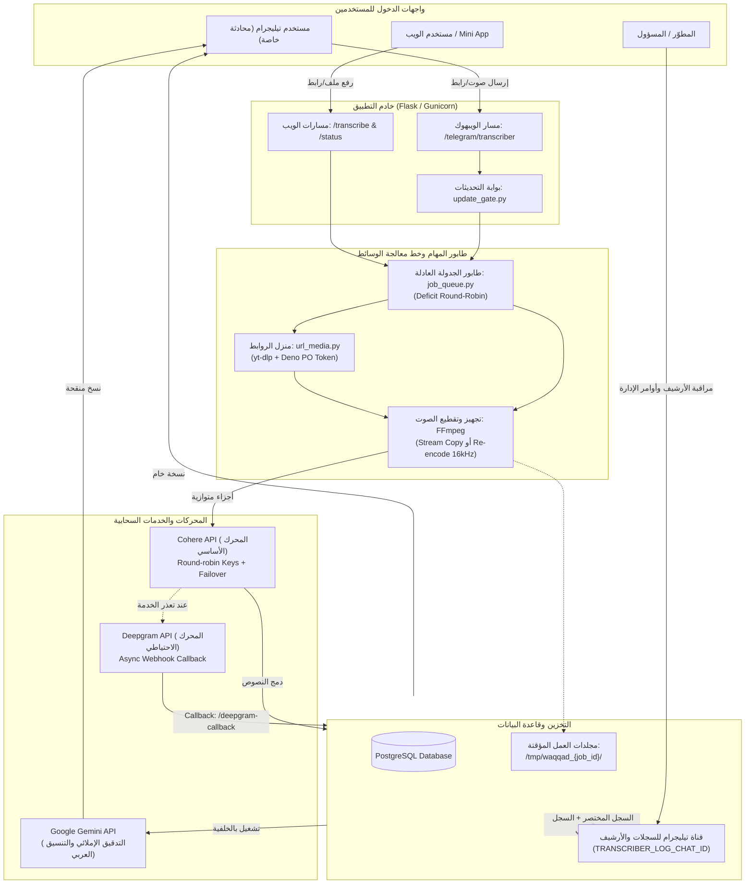
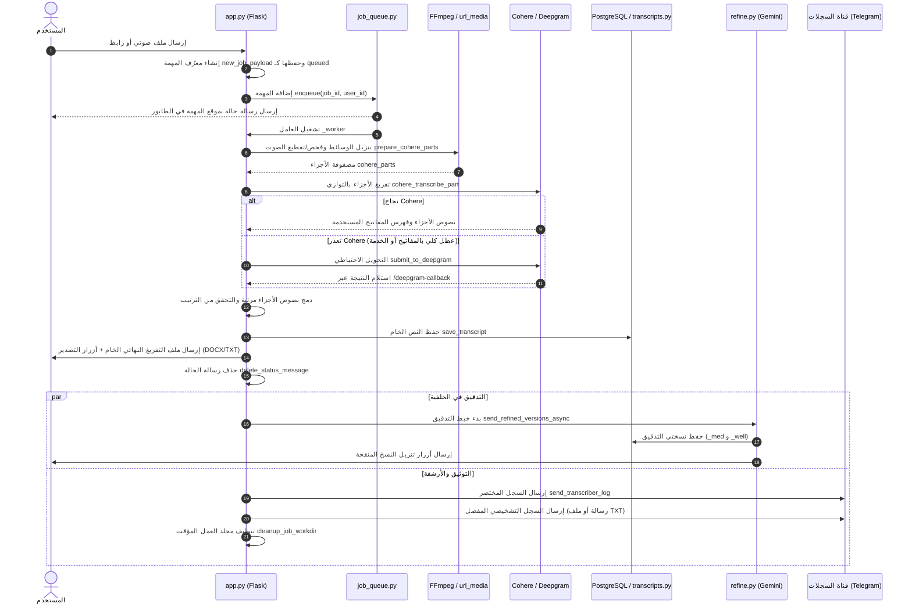
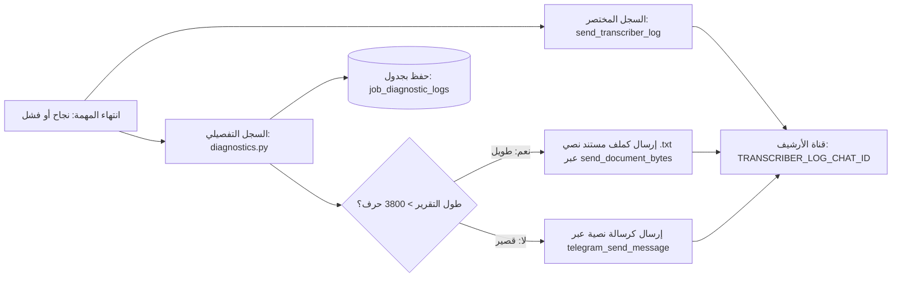

# توثيق مشروع مفرّغ الوقّاد التقني الشامل (PROJECT.md)

> [!IMPORTANT]
> هذا الملف هو المرجع التقني والهندسي الدائم لمشروع **مفرّغ الوقّاد (Waqqad Transcriber)**.  
> صُمم هذا المستند ليُمكّن أي وكيل ذكاء اصطناعي (AI Agent) أو مطوّر برمجي جديد من فهم معمارية النظام، دورة حياة المهام، قرارات التصميم، ومسارات التنفيذ دون الحاجة إلى استكشاف الكود من الصفر.

---

## 1. Project Overview (نظرة عامة على المشروع)

### 1.1 وظيفة المشروع وأهدافه
**مفرّغ الوقّاد** هو نظام متكامل ومُحسّن لتفريغ وتحويل التسجيلات الصوتية والمرئية إلى نصوص عربية دقيقة، يجمع بين محركات الذكاء الاصطناعي المتقدمة وتجربة مستخدم فورية عبر منصة تيليجرام (محادثات مباشرة وواجهة تطبيق مصغر Mini App) بالإضافة إلى واجهة ويب برمجية.

### 1.2 الميزات الحالية (المطبقة فعلياً)
- **التفريغ الصوتي الذكي فائق الدقة:**
  - المحرك الأساسي: **Cohere API** (نموذج تفريغ عربي متخصص).
  - المحرك الاحتياطي التلقائي: **Deepgram API** (يعمل تلقائياً عند تعطل Cohere أو استنفاد حصص المفاتيح).
- **التفريغ المتوازي للأجزاء:** تقطيع الملفات الطويلة ومعالجة أجزائها بالتوازي لتقليل زمن المعالجة الإجمالي بنسبة تصل إلى 60%.
- **التدقيق والتنقيح الآلي المتعدد (Multi-tier Refinement):**
  - استخدام **Google Gemini** لإنتاج نسختين إضافيتين تلقائياً في الخلفية:
    1. نسخة مصححة إملائياً ونحوياً (`conservative` / `_med`).
    2. نسخة محسّنة ومقسمة لفقرات وعناوين (`liberal` / `_well`).
  - مسار متخصص للقصائد والأبيات الشعرية (`poetry`).
- **تفريغ الروابط الخارجية والفيديو:**
  - تنزيل ومعالجة مقاطع يوتيوب عبر `yt-dlp` مع دعم كامل لحل تحديات JavaScript وProof of Origin Tokens (POT).
  - تنزيل روابط الصوت والفيديو المباشرة مع حماية صارمة ضد هجمات SSRF.
- **إرسال واستقبال متعدد القنوات:**
  - استقبال مباشر للملفات داخل محادثة بوت تيليجرام (حتى 20 ميجابايت عبر API البوت).
  - صفحة ويب وتطبيق Mini App لرفع الملفات الكبيرة (حتى 150 ميجابايت للروابط).
- **البحث المتقدم والتصدير:**
  - بحث لحظي داخل نصوص التفريغ كاملة عبر أمر `/find` باستخدام خوارزمية تطبيع عربي متقدمة (تجاهل التشكيل وتوحيد الهمزات وحذف السوابق مثل "الـ").
  - تصدير فوري بصيغتي TXT وDOCX منسقة بالكامل مع دعم اتجاه اليمين لليسار (RTL).
- **نظام الورّاق (Al-Warraq):** مكتبة سحابية مدمجة داخل نفس الخدمة لأرشفة المستندات وتنظيمها في مجلدات عبر بوت وتطبيق مصغر.
- **نظام سجلات تشخيصية تفصيلي (Detailed Diagnostics):** قياس دقيق بالمللي ثانية لكل مرحلة من استخراج وتقسيم وطلبات API وموارد التشغيل دون كشف أي أسرار.

### 1.3 مسارات الاستخدام والمستخدمون
1. **المستخدم العادي (Telegram Chat):** يرسل مقطع صوتي أو فيديو أو رابط يوتيوب في المحادثة -> يستلم رسالة تفاعلية تبين التقدم -> يستلم النتيجة كملف نصي مع أزرار تصدير DOCX وTXT ونسخ التدقيق.
2. **مستخدم واجهة الويب / Mini App:** يفتح الواجهة المصغرة الموثقة عبر Telegram WebApp -> يرفع ملفات كبيرة أو يدخل روابط -> يتابع حالة الطابور والتفريغ -> ينزل الملفات مباشرة.
3. **المسؤول والمطوّر:**
   - متابعة العمليات عبر قناة الأرشيف الخاصة (`TRANSCRIBER_LOG_CHAT_ID`) التي تستقبل السجل المختصر فورياً يعقبه السجل التشخيصي المفصل (كنص أو كملف `.txt`).
   - استخدام أوامر الإدارة في تيليجرام: `/stats`, `/users`, `/allusers`, `/block`, `/unblock`, `/cookies`, `/msg`.
   - استعلام الـ API عبر `/diagnostic-log/<job_id>`.

---

## 2. Technology Stack (حزمة التقنيات)

| التقنية / المكتبة | الإصدار المعتمد | الوظيفة ودورها في النظام |
|---|---|---|
| **Python** | `3.12-slim-bookworm` | لغة الخادم والبيئة الأساسية لتنفيذ كافة العمليات والخدمات. |
| **Flask** | `3.1.3` | إطار عمل الويب الأساسي لإدارة المسارات (Routes)، الويبهوك، والـ REST APIs. |
| **Gunicorn** | `26.2.0` | خادم WSGI للإنتاج. يعمل بعامل واحد (`--workers 1`) مع 4 خيوط (`--threads 4`). |
| **psycopg & psycopg-pool** | `3.3.6` / `3.3.3` | مشغل PostgreSQL غير المتزامن ومجمع الاتصالات المركزي (`ConnectionPool`). |
| **requests** | `2.34.2` | التعامل مع استدعاءات REST API الخارجية (Telegram, Cohere, Deepgram, Gemini). |
| **flask-cors** | `6.0.5` | إدارة ترويسات مشاركة الموارد عبر النطاقات لصفحة الويب وتطبيق Mini App. |
| **yt-dlp** | `2026.10.26` | استخراج وتحميل الصوت من روابط يوتيوب ومصادر الوسائط المتعددة. |
| **yt-dlp-ejs** | `0.8.0` | مكوّن تنفيذ محرك JavaScript لحل تحديات التوقيع والتحديات الخوارزمية في يوتيوب. |
| **bgutil-ytdlp-pot-provider** | `2.0.2` | مزود توكن إثبات الأصل (PO Token) لمنع حجب يوتيوب لعناوين خوادم الاستضافة. |
| **Deno** | `2.9.5` (عبر Docker) | بيئة تشغيل JavaScript فائقة السرعة تستخدم لتوليد توكنات POT وحل تحديات يوتيوب. |
| **FFmpeg** | إصدار نظام التشغيل | معالجة الوسائط، فحص المدد والترميز، تقطيع MP3 السريع، والتحويل إلى 16kHz mono. |
| **PostgreSQL** | السحابي (Supabase / Render) | قاعدة البيانات المركزية لحفظ بيانات المهام، النصوص، الإعدادات، والحظر. |

---

## 3. System Architecture (معمارية النظام)

### 3.1 الهيكل البرمجي ومسؤوليات المكونات
- [app.py](./app.py): نقطة الدخول والربط الشاملة؛ إعداد مسارات Flask، استقبال ويبهوك تيليجرام، تنسيق تشغيل المهام، إدارة رسائل الحالة، وإرسال السجلات.
- [job_queue.py](./job_queue.py): طابور مهام التفريغ العادل داخل الذاكرة (`Fair-Share Queue`)؛ يمنع احتكار الموارد ويتحكم في عدد العمال المتزامنين.
- [diagnostics.py](./diagnostics.py): نظام جمع القياسات التشخيصية، تطهير الأسرار، حفظ سجلات التشخيص في PostgreSQL، وإرسالها لقناة الأرشيف.
- [db.py](./db.py): مدير اتصالات قاعدة البيانات ومجمع الاتصالات المركزي (`ConnectionPool`).
- [transcripts.py](./transcripts.py): مستودع حفظ النصوص ومحرك البحث العربي اللحظي المبني على المطابقة المعجمية وفهارس Trigram.
- [refine.py](./refine.py): محرك التدقيق اللغوي وإعادة الصياغة والتنسيق عبر Google Gemini API.
- [url_media.py](./url_media.py): استخراج وتحميل الوسائط من يوتيوب والروابط المباشرة مع الحماية من SSRF وفحص الأحجام.
- [bot_upload.py](./bot_upload.py): تفريغ ومعالجة الملفات المرفوعة مباشرة من محادثة تيليجرام وإدارتها عبر `getFile`.
- [exporters.py](./exporters.py): توليد ملفات DOCX العربية الموجهة RTL دون استخدام مكتبات ثقيلة وبناء ملفات TXT.
- [update_gate.py](./update_gate.py): بوابة منع تكرار تحديثات تيليجرام والحماية من الرسائل المعاد تشغيلها (Idempotency).
- [warraq.py](./warraq.py) & [warraq_miniapp.py](./warraq_miniapp.py): محرك الورّاق لأرشفة المستندات وواجهة الـ Mini App التفاعلية.

### 3.2 مخطط المعمارية وسير البيانات (Mermaid Architecture Diagram)



---

## 4. Transcription Lifecycle (دورة حياة مهمة التفريغ)



### 4.1 تفاصيل مراحل التنفيذ
1. **استقبال الطلب وإنشاء المهمة:** يُستقبل الطلب إما عبر مسار الويبهوك `POST /telegram/transcriber` أو مسار الويب `POST /transcribe`. تُنشأ المهمة بحالة `queued` في جدول `jobs` وتُسجل في جامع التشخيص `diagnostics.get_collector(job_id)`.
2. **استخراج الصوت والتحميل:**
   - من تيليجرام: يتم التحميل عبر `download_telegram_file` وتُخزن في مسار العمل `/tmp/waqqad_{job_id}/input.*`.
   - من رابط: تتولى [url_media.py](./url_media.py) الفحص والتنزيل مع التحقق من الامتدادات المدعومة ومنع عناوين الشبكات الداخلية.
3. **تجهيز وتقطيع الصوت (`prepare_cohere_parts`):**
   - الملفات ذات الحجم $\le 24$ ميجابايت من صيغ MP3 أو WAV تُمرر مباشرة دون أي تقطيع أو تعديل.
   - ملفات MP3 الأكبر من 24 ميجابايت تُقطع عبر ميزة `stream copy` في FFmpeg دون إعادة ترميز (تقطيع فوري بأجزاء مدتها 20 دقيقة وحجم أقل من 24MB).
   - باقي الصيغ (m4a, ogg, wav غير المتوافق) تُحوّل إلى MP3 أحادي القناة (mono) بتردد 16kHz ومعدل بت 24kbps وتُقطع.
4. **محركات التفريغ والتبديل (Failover & Fallback):**
   - **Cohere API:** المحرك الأساسي؛ يستدعي النموذج عبر طلبات HTTPS متعددة لمفاتيح الـ API بالتناوب (Round-robin).
   - إذا رد المفتاح بكود `401`, `403`, أو `429`، يتم الانتقال تلقائياً إلى المفتاح التالي في القائمة المحددة في `COHERE_API_KEYS`.
   - إذا كانت أكواد الخطأ ناتجة عن تعطل الخادم السحابي `500`, `502`, `503`, `504` أو انقطاع شبكي، يُفعَّل المحرك البديل فوراً.
   - **Deepgram API:** المحرك الاحتياطي؛ يُستدعى بوضع غير متزامن (`callback`) مع ترويسة أمان موقعة `HMAC-SHA256` عبر المسار `POST /deepgram-callback`.
   - في حال علقت مهمة لدى Deepgram، يعمل مراقب خامل (`deepgram-reaper`) كل 10 دقائق لتنظيف المهام التي تجاوزت مهلتها وإشعار المستخدم.
5. **تجميع النتائج والتنظيف:**
   - تجمع نصوص الأجزاء طبقاً لفهرسها الأصلي وتُفحص للتأكد من عدم سقوط أي جزء (`order_verified`).
   - تُحفظ النتيجة في جدول `transcripts` وتُرسل النتيجة المكتملة للمستخدم في تيليجرام.
   - يُطلق خيط التدقيق التلقائي غير المتزامن لإنتاج نسختي التدقيق.
   - يتم إرسال السجلين المختصر والتشخيصي، ثم يُحذف مجلد العمل المؤقت بالكامل عبر `cleanup_job_workdir(job_id)`.

---

## 5. Queue & Concurrency (الطابور والتزامن)

### 5.1 معمارية الطابور العادل (Fair-Share Scheduling)
يحتوي [job_queue.py](./job_queue.py) على طابور مهام داخل الذاكرة يعتمد خوارزمية الجدولة العادلة بالوقت الافتراضي (Virtual Time / Deficit Round-Robin):
- **مبدأ العدالة:** إذا قام مستخدم برفع 20 ملفاً دفعة واحدة، وقام مستخدم آخر برفع ملف واحد بعدها، فلن ينتظر المستخدم الثاني انتهاء ملفات المستخدم الأول العشرين؛ بل يُقدَّم ملف المستخدم الجديد تلقائياً لأن وقته الافتراضي أقل (لديه مهام أقل قيد التشغيل).
- **الحفاظ على الترتيب الفردي (FIFO):** مهام المستخدم الواحد تحافظ على ترتيب رفعها الأصلي دائماً.
- **عدد العمال (`TRANSCRIBER_QUEUE_WORKERS`):** افتراضياً عاملان (`WORKERS = 2`) يعالجان المهام بالتوازي من الطابور.

### 5.2 قيد Gunicorn الصارم (`workers=1`)
> [!WARNING]
> يعمل خادم Gunicorn على الإنتاج بعامل واحد وخيوط متعددة:
> ```bash
> gunicorn --workers 1 --threads 4 --timeout 7200 --bind 0.0.0.0:10000 app:app
> ```
> **السبب المعماري:** طابور المهام وحالة العمال ومجمع التشخيصات تعيش داخل ذاكرة العملية الواحدة (`in-memory threading.Condition` و `threading.Lock`). تشغيل أكثر من عامل Gunicorn سيؤدي إلى إنشاء طوابير منفصلة داخل كل عملية وتشتت حالة المهام وتعارض قفل الموارد.

### 5.3 توازي أجزاء Cohere (`COHERE_CONCURRENCY`)
- عند تفريغ ملف مقسم إلى عدة أجزاء (مثلاً 6 أجزاء)، يقوم التطبيق بتنفيذ طلبات التفريغ بالتوازي عبر `ThreadPoolExecutor`:
  ```python
  max_workers = min(total_parts, COHERE_CONCURRENCY)  # القيمة الافتراضية 3
  ```
- يتم توزيع الأجزاء المتزامنة على مفاتيح Cohere المختلفة بنظام Round-Robin لمنع تجاوز معدل الطلبات (Rate Limits).

---

## 6. Database & Storage (قاعدة البيانات والتخزين)

### 6.1 مجمع الاتصالات المركزي (`db.py`)
يستخدم النظام مكتبة `psycopg-pool` لإنشاء مجمع اتصالات مركزي مع خادم PostgreSQL:
- `DATABASE_POOL_MIN`: الحد الأدنى للاتصالات المفتوحة (افتراضي 1).
- `DATABASE_POOL_MAX`: الحد الأقصى للاتصالات (افتراضي 10).
- `DATABASE_POOL_TIMEOUT`: مهلة انتظار استعارة اتصال (افتراضي 30.0 ثانية).
- ميزة الإغلاق الآلي للاتصالات عند إنهاء التطبيق عبر `atexit.register(close_all_pools)`.

### 6.2 جداول قاعدة البيانات ومخططاتها (Database Schemas)

#### 1. جدول المهام الأساسية (`jobs`)
```sql
CREATE TABLE IF NOT EXISTS jobs (
    job_id TEXT PRIMARY KEY,
    data JSONB NOT NULL,
    created_at TIMESTAMPTZ DEFAULT NOW(),
    updated_at TIMESTAMPTZ DEFAULT NOW()
);
```
- يحتوي حقل `data` على حالة المهمة (`status`)، المرحلة (`stage`)، اسم الملف الأصلي، معرّف تيليجرام، وتفاصيل المحرك.

#### 2. جدول نصوص التفريغ والبحث (`transcripts`)
```sql
CREATE TABLE IF NOT EXISTS transcripts (
    id            BIGSERIAL PRIMARY KEY,
    job_id        TEXT NOT NULL,
    user_id       BIGINT NOT NULL,
    kind          TEXT NOT NULL, -- 'raw', 'conservative', 'liberal', 'summary'
    title         TEXT,
    language      TEXT,
    duration_secs INTEGER,
    chars         INTEGER NOT NULL DEFAULT 0,
    content       TEXT NOT NULL,
    content_norm  TEXT,          -- النص المطبّع للبحث السريع
    created_at    TIMESTAMPTZ NOT NULL DEFAULT NOW(),
    UNIQUE (job_id, kind)
);
CREATE INDEX IF NOT EXISTS transcripts_user_time ON transcripts(user_id, created_at DESC);
CREATE INDEX IF NOT EXISTS transcripts_norm_trgm ON transcripts USING GIN (content_norm gin_trgm_ops);
```

#### 3. جدول السجلات التشخيصية التفصيلية (`job_diagnostic_logs`)
```sql
CREATE TABLE IF NOT EXISTS job_diagnostic_logs (
    job_id TEXT PRIMARY KEY,
    status TEXT NOT NULL,         -- 'completed' أو 'failed'
    data JSONB NOT NULL,          -- كافة القياسات والأرقام بصيغة JSON
    formatted_text TEXT NOT NULL, -- نص التقرير المنسق
    created_at TIMESTAMPTZ DEFAULT NOW()
);
```

#### 4. الجداول المساندة
- `app_settings (key TEXT PRIMARY KEY, value TEXT NOT NULL, updated_at TIMESTAMPTZ)`: حفظ الإعدادات الديناميكية كملفات كوكيز يوتيوب.
- `blocked_users (user_id TEXT PRIMARY KEY, created_at TIMESTAMPTZ)`: قائمة معرّفات المستخدمين المحظورين من الخدمة.
- `feedback (job_id TEXT PRIMARY KEY, verdict TEXT NOT NULL, created_at TIMESTAMPTZ)`: تقييمات الجودة وتغذية المستخدمين الراجعة.
- جداول الورّاق: `folders`, `files`, `user_states`, `user_ui_state`.

### 6.3 إدارة الملفات المؤقتة والتنظيف (`/tmp`)
- كل مهمة تنشئ مجلداً معزولاً: `/tmp/waqqad_{job_id}/`.
- عند اكتمال المهمة أو فشلها، يُستدعى `cleanup_job_workdir(job_id)` الذي يحذف المجلد الفرعي بأمان عبر `shutil.rmtree`.
- تم تحصين التنظيف بحيث لا يقطع ملفات القراءة الخاصة بالتدقيق الآلي في الخلفية، ويتم فحص ومسح المجلدات العالقة القديمة عند إقلاع التطبيق عبر `_cleanup_stale_workdirs()`.

---

## 7. Logging & Diagnostics (السجلات والتشخيص)

لكل مهمة تفريغ في المشروع (سواء نجحت أو فشلت)، يتم توليد نسختين من السجلات:



### 7.1 السجل المختصر (Current Brief Log)
- **القناة:** يُرسل فورياً إلى قناة الأرشيف `TRANSCRIBER_LOG_CHAT_ID`.
- **المحتوى:** رسالة نصية موجزة تحتوي: اسم المستخدم، اسم الملف، الحجم بالميجابايت، المحرك المستخدم، عدد الأجزاء، مفاتيح Cohere المستخدمة، مدة المعالجة، ومعرّف المهمة.
- لم يطرأ عليه أي تغيير للحفاظ على توافق الأنظمة والمشاهدة اليومية للمسؤولين.

### 7.2 السجل التشخيصي التفصيلي (Detailed Diagnostic Log)
- يُجمع عبر [diagnostics.py](./diagnostics.py) خطوة بخطوة عبر فئة `JobDiagnosticCollector`.
- **المعلومات الدقيقة المسجلة:**
  1. توقيتات دقيقة (وقت الوصول، بدء المعالجة، زمن الانتظار بالطابور، مدة المعالجة الكلية).
  2. تفاصيل استخراج وتقسيم الصوت، عدد الأجزاء وحجم كل جزء وزمن التقسيم.
  3. محرك التفريغ، نمط التنفيذ (`parallel` أو `sequential`)، التزامن الفعلي والمسموح.
  4. سجل تفصيلي لكل طلب API: رقم الجزء، توقيت البدء والانتهاء، المدة بالثواني، عدد الأحرف الناتجة، والمفتاح المستخدم (مشفراً كرقم فهرس فقط).
  5. تفاصيل الدمج والتحقق من الترتيب وسلامة الأرشيف وتنظيف المجلد المؤقت.
  6. قياس خفيف للذاكرة (RSS) وعدد المهام النشطة والمنتظرة لحظة البدء.
- **آلية التسليم الذكي:**
  - إذا كان السجل قصيراً ($\le 3800$ حرف): يُرسل كرسالة نصية لقناة الأرشيف.
  - إذا كان السجل طويلاً ($> 3800$ حرف): يُرسل كملف مستند نصي `.txt` عبر `send_document_bytes` مع عنوان يتضمن معرف المهمة واسم الملف.
  - **منع التكرار (Idempotency):** محمي بقفل `_SENT_DIAGNOSTIC_JOBS` حتى لا تتكرر النسخ عند إعادة محاولة الأرشفة.
  - إذا تطابق `DIAGNOSTIC_LOG_CHAT_ID` مع `TRANSCRIBER_LOG_CHAT_ID` تُرسل نسخة واحدة فقط دون ازدواجية.

### 7.3 تطهير البيانات الحساسة والأسرار (Data Sanitization)
تطبق دالة `sanitize_secrets` تعبيرات نمطية صارمة تمسح تلقائياً:
- مفاتيح الـ API ورموز الوصول (`Bearer ...`, `Token ...`, `api_key=...`).
- توكنات بوتات تيليجرام (`[BOT_TOKEN_REDACTED]`).
- المعلمات السرية في الروابط الموقعة (`?X-Goog-Signature=...`).
- النص الكامل للتفريغ لا يُسجل إطلاقاً داخل السجل التشخيصي، ويكتفى فقط بإحصاء عدد الأحرف والكلمات.

---

## 8. Deployment & Infrastructure (النشر والبنية التحتية)

### 8.1 بيئة التشغيل والاستضافة
- **المنصة المعتمدة:** مُهيأ ومُختبر للتشغيل على **Render** أو خوادم Linux Docker المستقلة.
- **صورة Docker:** مبنية على مرحلتين (Multi-stage build) لدمج Deno ومزود توكنات يوتيوب POT الجاهز `bgutil-ytdlp-pot-provider:2.0.2-deno` داخل `python:3.12-slim-bookworm`.
- **المستخدم غير الجذري:** يعمل التطبيق تحت المستخدم `app` (UID=10001, GID=10001) لتعزيز الأمان.
- **فحص الجاهزية (Healthcheck):** يُفحص دورياً عبر مسار `GET /health` على المنفذ `10000`.

### 8.2 دليل متغيرات البيئة (Environment Variables Reference)

| المتغير | النوع | القيمة الافتراضية | الوصف الإلزامي |
|---|---|---|---|
| `DATABASE_URL` | نص | *إلزامي* | رابط الاتصال بقاعدة بيانات PostgreSQL الأساسية. |
| `TELEGRAM_BOT_TOKEN` | نص | *إلزامي* | توكن بوت مفرّغ الوقّاد الصادر من BotFather. |
| `COHERE_API_KEYS` | نصوص مفصولة بفواصل | *إلزامي* | قائمة مفاتيح Cohere API للتدوير بالتناوب. |
| `DEEPGRAM_API_KEY` | نص | اختياري | مفتاح محرك Deepgram الاحتياطي. |
| `GEMINI_API_KEY` | نص | اختياري | مفتاح Google Gemini لخدمات التدقيق اللغوي الآلي. |
| `BASE_URL` | رابط URL | *إلزامي بالإنتاج* | الرابط الخارجي العام للخدمة لاستقبال الويبهوك والروابط. |
| `TRANSCRIBER_LOG_CHAT_ID` | معرّف تيليجرام | اختياري | معرّف القناة/المحادثة الخاصة بالأرشيف وسجلات التفريغ. |
| `TRANSCRIBER_QUEUE_WORKERS` | عدد صحيح | `2` | عدد المهام المعالجة متزامنة في طابور التفريغ. |
| `COHERE_CONCURRENCY` | عدد صحيح | `3` | الحد الأقصى للأجزاء المتزامنة في معالجة الملف الواحد. |
| `TRANSCRIBER_MAX_UPLOAD_MB` | عدد صحيح | `20` | أقصى حجم لملفات المحادثة المباشرة في تيليجرام. |
| `TRANSCRIBER_URL_MAX_MB` | عدد صحيح | `150` | أقصى حجم للملفات المنزلة عبر الروابط ويوتيوب. |
| `TELEGRAM_WEBHOOK_SECRET` | نص | اختياري (موصى به) | التوكن السري لحماية ويبهوك تيليجرام من الانتحال. |
| `REFINE_CONCURRENCY` | عدد صحيح | `3` | عدد القطع المتزامنة أثناء التدقيق عبر Gemini. |
| `REFINE_MODEL` | نص | `gemini-3.5-flash-lite` | نموذج Gemini المعتمد للتدقيق والتنسيق. |
| `WARRAQ_BOT_TOKEN` | نص | اختياري | توكن بوت الورّاق المدمج. |
| `WARRAQ_DATABASE_URL` | نص | اختياري | قاعدة بيانات خدمة الورّاق. |
| `WARRAQ_STORAGE_CHAT_ID` | معرّف تيليجرام | اختياري | القناة المخصصة لتخزين ملفات الورّاق. |

---

## 9. Security (الأمان والحماية)

1. **الوقاية من هجمات تزوير الطلبات بالخادم (SSRF Prevention):**
   - في [url_media.py](./url_media.py)، يتم حظر وتصفية أي روابط تشير إلى `localhost` أو العناوين المحلية `127.0.0.1` وشبكات الـ Private IP (`10.0.0.0/8`, `172.16.0.0/12`, `192.168.0.0/16`) لحماية شبكة الاستضافة الداخلية.
   - يتم التحقق من عنوان الـ IP الفعلي لكل تحويل (HTTP Redirect) قبل المتابعة.
2. **التحقق من توقيع Telegram WebApp (`initData` Validation):**
   - في مسارات الويب المصغرة `/status` و`/download` و`/refine`، يتم فحص تجزئة البيانات عبر `HMAC-SHA256` باستخدام مفتاح البوت للتأكد من هوية المستخدم وامتلاكه الفعلي للمهمة، ولا يتم الاعتماد على معرّفات مرسلة في النماذج.
3. **حماية مسار Webhook:**
   - فحص الترويسة `X-Telegram-Bot-Api-Secret-Token` ومطابقتها مع `TELEGRAM_WEBHOOK_SECRET` لرفض الطلبات العشوائية أو المشبوهة برمز `403`.
4. **حماية التواقيع والمكالمات الاحتياطية:**
   - مسار `/deepgram-callback` محمي بتوقيع مشفر برقم المهمة عبر `_callback_token(job_id)`.
5. **منع هجمات التكرار (Replay Attacks):**
   - فئة `SeenUpdates` في [update_gate.py](./update_gate.py) تحفظ معرّفات الـ `update_id` الحديثة وترفض الرسائل المكررة أو القديمة التي تجاوزت مهلتها.
6. **نظام الحظر الإداري (`blocked_users`):**
   - حجب المستخدمين المزعجين وحظرهم من رفع الملفات أو الوصول لقدرات الخادم.

---

## 10. Testing (نظام الاختبارات وضمان الجودة)

### 10.1 تشغيل حزمة الاختبارات
يحتوي المشروع على حزمة اختبارات تكامل ووحدات شاملة (189 اختباراً مؤتمتاً بنجاح 100%):
```bash
# تشغيل كامل حزمة الاختبارات مع ضبط المسار المؤقت:
TMPDIR=/data/user/0/com.agy/files/usr/tmp python -m unittest discover -s tests

# تشغيل ملف اختبارات محدد:
python -m unittest tests/test_diagnostic_logs.py
python -m unittest tests/test_fair_queue.py
python -m unittest tests/test_cohere_parallel.py
```

### 10.2 تغطية الاختبارات الأساسية
- [tests/test_diagnostic_logs.py](./tests/test_diagnostic_logs.py): اختبار إرسال السجلين المختصر والتفصيلي، تحويل الملفات الطويلة لـ TXT، منع التكرار، وتطهير المفاتيح.
- [tests/test_fair_queue.py](./tests/test_fair_queue.py): اختبار الجدولة العادلة والتأكد من عدم تجويع المستخدمين الجدد عند زحام المهام.
- [tests/test_cohere_parallel.py](./tests/test_cohere_parallel.py): اختبار تقطيع ومعالجة أجزاء Cohere بالتوازي والحفاظ على الترتيب والتحويل الاحتياطي.
- [tests/test_cleanup.py](./tests/test_cleanup.py): اختبار تنظيف مجلدات العمل المؤقتة في حالات النجاح والفشل وعدم حذف الملفات أثناء التدقيق.
- [tests/test_transcripts.py](./tests/test_transcripts.py): اختبار حفظ النصوص والبحث العربي المعجمي وتطبيع الحروف والسوابق.
- [tests/test_url_media.py](./tests/test_url_media.py): اختبار تنزيل الروابط والتحقق من أمان الـ IP والحماية من SSRF.
- [tests/test_update_gate.py](./tests/test_update_gate.py): اختبار صد الرسائل المكررة ومنع إعادة التشغيل.
- [tests/test_exporters.py](./tests/test_exporters.py): اختبار سلامة ملفات DOCX RTL الناتجة وملفات TXT.

---

## 11. Important Technical Decisions (القرارات التقنية المعمارية وأسبابها)

1. **الاعتماد على Gunicorn بعامل واحد فقط (`--workers 1`):**
   - *القرار:* تشغيل عامل واحد مع خيوط متعددة بدلاً من تعدد العمال.
   - *السبب:* طابور الجدولة العادلة وحالة المهام ومجمع التشخيصات تعيش في ذاكرة التطبيق (`In-memory Threading`). تعدد العمال كان سيتطلب بنية تحتية ثقيلة ومكلفة (مثل Redis وCelery)، وهو ما يتعارض مع بساطة تشغيل المشروع وخفته وميزانية استضافته المجانية/المنخفضة.
2. **استخدام Cohere كمحرك أساسي وDeepgram كاحتياطي:**
   - *القرار:* تخصيص Cohere للمسار الافتراضي وعدم استخدام Deepgram إلا عند تعطل Cohere أو نفاذ الحصص.
   - *السبب:* Cohere يقدم دقة لغوية عربية استثنائية ونموذج تفريغ متميز، في حين يوفر Deepgram سرعة وموثوقية عالية جداً كشبكة أمان تحمي المستخدم من توقف الخدمة.
3. **تقطيع الصوت عبر FFmpeg Stream Copy:**
   - *القرار:* تقطيع ملفات MP3 بنسخ التيارات الصوتية دون إعادة فك وضغط الترميز (`-c copy`).
   - *السبب:* إعادة ترميز ملف مدته ساعتان تستغرق دقائق وتستهلك المعالج؛ بينما النسخ المباشر يستغرق أقل من ثانيتين مع الحفاظ على نقاء الصوت الأصلي.
4. **توليد مستندات DOCX العربية دون مكتبات خارجية:**
   - *القرار:* بناء ملفات DOCX في [exporters.py](./exporters.py) بتجميع ملفات الـ XML وضغطها كـ Zip مباشرة.
   - *السبب:* مكتبة `python-docx` التقليدية ثقيلة، تفتقر لدعم اتجاه اليمين لليسار (RTL) بشكل موثوق، وتضيف اعتمادات نظام غير ضرورية.
5. **تسليم السجلات التشخيصية عبر نفس قناة الأرشيف كـ TXT عند الطول:**
   - *القرار:* عدم إلزام المسؤول بإنشاء قناة جديدة، وإرسال السجل التشخيصي تلقائياً بعد المختصر، وتحويله لملف `.txt` إذا تجاوز 3800 حرف.
   - *السبب:* حل مشكلة حد رسائل تيليجرام (4096 حرف) دون بتر تفاصيل الأجزاء، وجمع كل ما يخص المهمة في مكان موحد يسهل الرجوع إليه.

---

## 12. Known Limitations & Technical Debt (القيود المعروفة والديون التقنية)

1. **طابور الذاكرة وإعادة التشغيل (In-Memory Queue Volatility):**
   - في حال إعادة تشغيل الخادم السحابي أثناء وجود مهام قيد الانتظار في الطابور، تضيع المهام المنتظرة في الذاكرة. (يتم معالجة المهام قيد التشغيل بتعليمها كـ `failed` عند الإقلاع عبر `_fail_orphaned_jobs`).
2. **اعتماد حل تحديات يوتيوب على Deno وPOT:**
   - يوتيوب يغيّر باستمرار خوارزميات الـ JavaScript وتحديات التحقق. الاعتماد على `bgutil-ytdlp-pot-provider` مستقر حالياً، لكنه يتطلب تحديثاً دورياً لحزم `yt-dlp` و`bgutil` عند حدوث تغييرات جذرية من طرف يوتيوب.
3. **حدود الذاكرة المؤقتة لـ Render:**
   - الملفات الضخمة جداً (أكثر من 150 ميجابايت) أثناء تنزيلها وتقطيعها تستهلك مساحة القرص المؤقت في `/tmp`. لذلك تم وضع سقف `TRANSCRIBER_URL_MAX_MB = 150` لضمان عدم امتلاء القرص.

---

## 13. Roadmap (خارطة الطريق المستقبلية)

### 13.1 ما هو مطبق فعلياً (Implemented) ✅
- تفريغ Cohere المتوازي مع تدوير المفاتيح والتبديل الاحتياطي لـ Deepgram.
- طابور الجدولة العادلة لمنع احتكار المستخدمين (Fair Scheduling).
- التدقيق الآلي المتعدد بـ Gemini للنسخ المصححة والمحسنة والشعرية.
- تفريغ روابط يوتيوب والروابط المباشرة مع الحماية من SSRF ودعم الكوكيز.
- محرك البحث العربي المتقدم في نصوص التفريغ وتصدير DOCX RTL.
- السجل التشخيصي المفصل المدمج وإرساله التلقائي كملف TXT للأرشيف.
- تنظيف المجلدات المؤقتة ومنع تسريب المساحة.

### 13.2 ما هو مقترح ومخطط له مستقبلاً (Planned) 📋
- **Persisted Queue:** نقل طابور المهام تدريجياً ليعتمد على جداول PostgreSQL (`SKIP LOCKED`) للسماح بتعدد عمال Gunicorn واستعادة المهام عند إعادة تشغيل الخادم دون الحاجة لـ Redis.
- **توليد الملخصات الذكية (Summarization):** تفعيل نموذج التلخيص التنفيذي للنصوص الطويلة تلقائياً كنسخة رابعة في `transcripts`.
- **دعم تفريغ قوائم التشغيل (Playlists):** تمكين استقبال قوائم يوتيوب وتفريغها في ملف موحد مع الحفاظ على ترتيب المقاطع.
- **لوحة تحكم للمسؤول عبر الويب (Admin Web Dashboard):** واجهة ويب متكاملة تتيح مراقبة المقاييس اللحظية وتحليل أداء المفاتيح دون الاكتفاء بأوامر تيليجرام.

---

## 14. AI Agent Working Guide (دليل عمل وكلاء الذكاء الاصطناعي)

إذا كنت وكيلاً برمجياً (AI Agent) تم تكليفك بالعمل على هذا المستودع، **يجب عليك اتباع القواعد التالية بدقة متناهية**:

1. **ابدأ دائماً بقراءة هذا الملف (`PROJECT.md`):** هو مصدر الحقيقة الأول لهندسة المشروع.
2. **افحص الملفات المرتبطة قبل تعديلها:** لا تفترض سلوك أي دالة أو متغير؛ استخدم أدوات قراءة الكود وتأكد من الأسطر الفعلية.
3. **احفظ السلوك الحالي وتجنب التغييرات الجذرية:** هذا مشروع إنتاجي مستقر يعمل لمستخدمين حقيقيين؛ الصيانة تهدف للإصلاح والتحسين التدريجي لا لإعادة كتابة المشروع (Refactoring) أو حذف الميزات.
4. **لا تلمس المعمارية المستقرة إلا بطلب صريح:** لا تقم بإضافة خوادم وسيطة مثل Redis أو مكتبات ثقيلة ما لم يُطلب ذلك بالاسم.
5. **الأمان أولاً:** ممنوع منعاً باتاً كتابة أي مفاتيح API، أو توكنات، أو أسرار حقيقية داخل الكود أو الاختبارات أو الالتزامات (Commits).
6. **الاختبارات إلزامية:**
   - شغّل الاختبارات قبل التعديل وبعده للتأكد من عدم حدوث أي تراجع.
   - أضف اختبارات وحدات وتكامل لكل ميزة أو إصلاح جديد في مجلد `tests/`.
   - **لا تدّعِ نجاح أي اختبار ما لم تنفذه فعلياً وتستلم نتيجته.**
7. **قواعد Git الإلزامية:**
   - ممنوع التعديل المباشر على فرع `main`.
   - أنشئ فرعاً مخصصاً للمهمة من أحدث `main`.
   - ارفع الفرع وأنشئ Pull Request واتركه مفتوحاً للمراجعة دون دمجه بنفسك.
